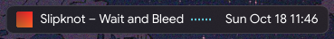
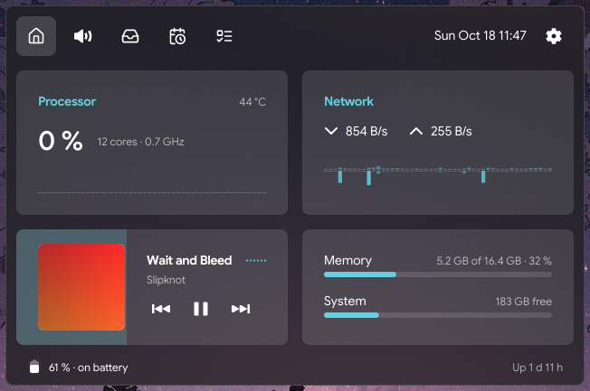

# cosmic-ext-island

English · [Česky](README.cs.md)





A Dynamic Island for the COSMIC desktop (Pop!_OS 24.04). The island sits **over the top panel**:
- at rest it shows the date and time,
- while something plays, it adds the cover, "artist – title" and bars that follow the sound,
- point at it and it opens into a home page, media controls, a shelf for files, a calendar and a
  to-do list.

It follows your COSMIC theme: interface font, accent color, light/dark mode, transparency, frosted
glass and corner radius. Changes in COSMIC Settings show up right away. It steps aside for
fullscreen videos and games.

## Parts

| Binary | What it does |
| --- | --- |
| `cosmic-ext-island` | The daemon. Puts a layer surface on the Overlay layer over the panel on each display and draws the island. |
| `cosmic-ext-island-applet` | A panel applet for the middle of the panel. Keeps room as wide as the island, so other applets are not hidden under it, and starts the daemon over D-Bus when it is not running. |

## Install

You need Rust 1.88 or newer (from [rustup](https://rustup.rs)) and `just`:

```bash
sudo apt install just pkg-config libxkbcommon-dev libwayland-dev
```

Install for your user, into `~/.local` (no sudo), with autostart and D-Bus activation:

```bash
just install
```

For all users:

```bash
just build-release && sudo just prefix=/usr install
```

A Debian package ends up in `target/debian`:

```bash
just deb
```

Then:
1. Log out and back in, or run `cosmic-ext-island`.
2. If you have applets in the middle of the panel (such as the date and time), the island covers
   them. The island's settings (Displays section) have a button that adds the *Dynamic Island* applet
   to the panel; it keeps room for the island and moves the others aside. You can also add it in
   **Settings → Desktop → Panel → Applets**. The date and time applet can go: the island shows both.

Uninstall with `just uninstall` (or `sudo just prefix=/usr uninstall`).

### Runtime dependencies

- COSMIC (cosmic-comp and cosmic-panel) on Wayland.
- `parec` (package `pulseaudio-utils`, works with PipeWire) for the bars next to the playing track.
  Without it the bars stand still.
- GNOME Online Accounts and `gnome-control-center` for Google Tasks.
- Optionally KDE Connect (`kdeconnect-cli`) to send files. LocalSend is not needed on this computer.

## Using it

- **Hover**: after a short delay (300 ms by default) the island opens; it closes when the pointer leaves.
- **Click**: opens the island and keeps it open. Another click or **Esc** closes it.
- **Middle click**: play/pause.
- **Home**: CPU use with history, clock speed and temperature, network speed (download up, upload
  down), a small player whose background fills as the track plays, and one card with memory and
  disks. Below that, the battery and uptime.
- **Media**: cover, title, seeking and controls. With lyrics switched on in the settings, the line
  being sung runs under the title and the microphone button shows the whole text, in time with the
  track. Lyrics come from [LRCLIB](https://lrclib.net); the island sends it the artist, title, album
  and length of the track, so lyrics are off until you switch them on.
- **Shelf**: drag files onto the island. It opens on the shelf, swells a little and its border
  breathes in the accent color; when you let go, it swallows the file. The shelf shows photo
  previews and file type icons. Drag files back out (they are always copied), click to open them,
  or send the whole shelf to a device.
  - **Several shelves**: **+** adds one, a double click renames it, the trash icon next to the
    selected shelf deletes it (asks first when it holds files; the files on disk stay). Hold a file
    over a shelf's name to drop it there.
  - **Clipboard and text**: on the open shelf, **Ctrl+V** (or the clipboard icon) adds what is on
    the clipboard: copied files, an image (kept as PNG) or text. Text can also be dragged in, for
    example selected in a browser. Pasted text and images are kept in
    `~/.local/share/cosmic-ext-island/snippets` and removed once no shelf holds them.
  - **Send to a device**: the send icon lists devices nearby. The island speaks the
    [LocalSend](https://localsend.org) protocol (v2) itself; the other device only needs the
    LocalSend app open. Paired KDE Connect devices show up there too.
- **Calendar**: the month, with today highlighted and the week number.
- **Tasks**: type a task and press Enter. A double click renames it, the cross deletes it. A ticked
  task is struck through and slides away; untick it in time and it stays. Tasks are kept in
  cosmic-config state (`~/.local/state/cosmic/io.github.jiricepelka.CosmicExtIsland`).
- **Bars next to the track** show the actual sound: while something plays, the island reads the
  monitor of the default output through `parec`. A recording stream named "Dynamic Island" shows
  up in the mixer only then.
- **Keyboard shortcut**: in Settings → Keyboard → Custom shortcuts, add the command:

  ```bash
  busctl --user call io.github.jiricepelka.CosmicExtIsland /io/github/jiricepelka/CosmicExtIsland io.github.jiricepelka.CosmicExtIsland Toggle
  ```

## Google Tasks

The tasks can sync with "My Tasks" in Google Tasks. GNOME Online Accounts handles signing in; the
island only asks it for an access token, so it needs no Google key of its own and never sees your
password.

1. In the island's settings, click **Open Online Accounts** (runs `gnome-control-center
   online-accounts`) and add a Google account. Keep **Tasks** switched on for it.
2. Switch on **Sync with Google Tasks**.

New, renamed, ticked and deleted tasks go to Google right away. Google's list is fetched when the
Tasks tab opens, every minute while it is open, and every 10 minutes otherwise.

## Settings

The gear in the open island shows the settings inside the island:
- which sections the island has (home, media, shelf, calendar, tasks); the last one can't be switched off,
- which displays show the island (same as the panel, all, the active one, selected ones),
- the clock format (empty follows the COSMIC Time applet),
- the delays before opening and closing,
- hiding the island when a window is fullscreen on its display (on by default),
- what the compact island shows,
- Google Tasks sync and lyrics.

Settings are stored with cosmic-config under `io.github.jiricepelka.CosmicExtIsland`.

## Development

```bash
just run
```

`--expand[=home|media|shelf|calendar|tasks|settings]` starts the island open on that tab, which is
handy for screenshots:

```bash
just run --expand=calendar
```

The opening animation follows [Boring Notch](https://boringnotch.com/): a spring (response 0.42 s,
damping 0.8) when opening and no overshoot (damping 1.0) when closing; the content fades and grows
from the top edge.

Tests and lints:

```bash
just check
```

The ignored tests need a live session: an MPRIS player named `org.mpris.MediaPlayer2.mock`, a
LocalSend receiver, or a Google account in GNOME Online Accounts. Run them with
`cargo test -- --ignored`.

## Icons

Icons come from the system COSMIC icon theme first. Where COSMIC has no fitting icon (shelf,
calendar, home, tasks), bundled [Lucide](https://lucide.dev) icons are used (ISC license, see
`res/icons/LICENSE-lucide`).

## License

GPL-3.0-only, see [LICENSE](LICENSE).
